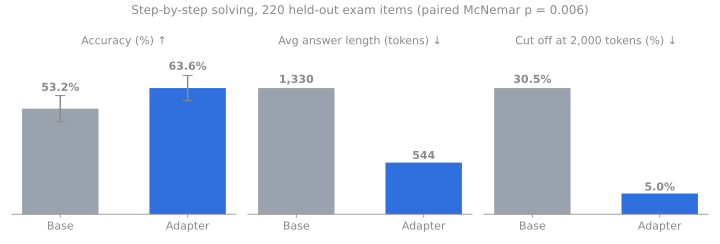
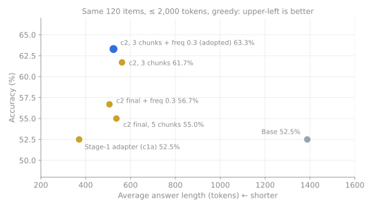
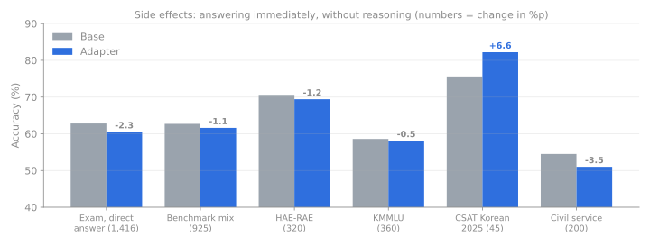

# 8GB 그래픽카드로 35B 모델을 학습시켜 봤다

[English](README.md) | **한국어**

> Qwen3.6-35B-A3B(MoE)에 LoRA를 붙여 한국어 시험 문제를 단계별로 더 잘 풀게 만든 개인 연구 기록

## 시작은 이랬다

집에 있는 컴퓨터는 평범하다. RTX 3070 8GB, RAM 16GB, Ryzen 5 5600X. 여기서 35B짜리 모델을 **돌리는** 것까지는 남들도 한다. 궁금했던 건 그다음이었다. **이 컴퓨터로 그 모델을 직접 학습시킬 수 있을까?**

보통 방법으로는 안 된다. 3비트로 줄여도 모델 파일이 12.7GB라서 GPU에 아예 안 올라가고, 일반적인 학습 도구는 모델을 불러오지도 못한다. 그래서 우회로를 찾기로 했다.

## 결과부터

학습에도 검색 자료에도 한 번도 쓰지 않은 가장 최근 연도 시험으로 쟀다. 두 모델 모두 같은 문항을 풀었고, 생각 모드는 껐고, greedy로 생성했고, 답은 최대 2,000토큰이다.

| | 원래 모델 | 학습한 어댑터 | 변화 |
|---|---|---|---|
| **단계별 풀이 정답률** (220문항) | 53.2% | **63.6%** | **+10.4%p** (대응 검정 p = 0.006) |
| 평균 답변 길이 | 약 1,330토큰 | **약 540토큰** | **2.4배 짧음** |
| 2,000토큰에서 잘린 답 | 30.5% | **5.0%** | 6분의 1 |
| 풀이 없이 바로 답하기 (1,416문항) | **62.8%** | 60.5% | −2.3%p |
| 한국어 벤치마크 묶음 (925문항) | **62.7%** | 61.6% | −1.1%p |
| 위키백과 글에서 원래 모델과 다음 토큰이 같은 비율 | 100% | 92.4% | 관문 92% 통과 ✔ |

한 줄로 줄이면 **"절반도 안 되는 길이로 더 많이 맞힌다."** 대신 공짜는 아니었다. 바로 답하라고 하면 조금 못해졌고, 일반 상식도 1%p쯤 떨어졌다. 그래서 내가 쓰는 채팅 앱에서는 객관식 시험 문제가 들어올 때만 이 어댑터를 켠다.

<b>+10.4%p는 믿을 만한가?</b>

- **짝지은 비교.** 두 모델이 같은 220문항을 풀었다. 어댑터만 맞힌 문항이 44개, 원래 모델만 맞힌 문항이 21개다 (McNemar 정확 검정, p = 0.006).
- **재현.** 설정은 앞 120문항으로 골랐다(+10.8%p, p = 0.041). 그다음 아무것도 바꾸지 않고 새 100문항을 풀게 했더니 54.0% → 64.0%로 같은 차이가 또 나왔다.
- **더 큰 표본.** 보류 문항 300개 전체에서 어댑터는 63.7%다.
- **찍기 편향 점검.** 프롬프트의 형식 예시가 "정답: ③"이다. 원래 모델은 ③을 너무 자주 고른다(78번인데, 실제로 정답이 ③인 문항은 51개). 어댑터는 그렇지 않다(57번). 정답이 ③이 아닌 문항만 세면 차이가 +13.7%p로 더 벌어진다.

### 생각 모드와 비교

원래 모델에는 생각(thinking) 모드가 있다. 켜면 토큰을 훨씬 많이 쓰는데, 여기서는 도움이 안 됐다. 앞 60문항만 쓴 결과라서 참고용이다.

| 설정 (같은 앞 60문항) | 정답률 | 문항당 토큰 |
|---|---|---|
| 원래 모델, 생각 모드 켬 (예산 3,000) | 48.3% | 약 2,970 |
| 원래 모델, 생각 모드 끔 | 50.0% | 약 1,390 (120문항 평균) |
| **어댑터, 생각 모드 끔** | **56.7%** | **약 540** |

### 무엇이 차이를 만들었나 (같은 120문항 비교)

| 설정 | 정답률 | 정답 형식으로 끝맺음 | 잘림 | 평균 토큰 |
|---|---|---|---|---|
| 원래 모델 | 52.5% | 74.2% | 32.5% | 1,388 |
| 1단계 어댑터 (공식 해설만 학습) | 52.5% | 89.2% | 5.8% | 371 |
| c2, 5묶음 전부 | 55.0% | 92.5% | 5.8% | 537 |
| c2, 5묶음 + 빈도 페널티 0.3 | 56.7% | 95.8% | 3.3% | 506 |
| c2, 3묶음 | 61.7% | 94.2% | 5.8% | 562 |
| **c2, 3묶음 + 빈도 페널티 0.3 (채택)** | **63.3%** | **95.0%** | **4.2%** | **524** |

- 1단계는 *형식*만 가르쳤다. 짧고 깔끔하게 끝맺게 됐지만 정답률은 그대로였다.
- 진짜 상승은 단계별 풀이를 학습한 2단계에서 나왔다.
- 오래 학습할수록 나빠졌다. 5묶음 버전은 정답률도 낮았고 망각 관문도 통과하지 못했다.

### 부작용

| 벤치마크 (바로 답하기) | 문항 | 원래 모델 | 어댑터 |
|---|---|---|---|
| 시험 전 과목 | 1,416 | **62.8%** | 60.5% |
| HAE-RAE Bench | 320 | **70.6%** | 69.4% |
| KMMLU (12과목) | 360 | **58.6%** | 58.1% |
| 2025 수능 국어 | 45 | 75.6% | **82.2%** |
| 공무원 시험 | 200 | **54.5%** | 51.0% |
| **벤치마크 전체** | **925** | **62.7%** | 61.6% |

국어 독해만 오르고 나머지는 모두 조금씩 내려갔다. 어댑터가 "먼저 풀고 결론 내기"를 배웠기 때문에, 바로 답하라고 하면 살짝 못한다.

### 이 PC에서 든 비용

| 방법 | 올려야 하는 것 | 8GB VRAM / 16GB RAM에서 되나? |
|---|---|---|
| 일반 LoRA (16비트, PEFT) | 가중치 약 70GB | ✘ 불러오지도 못함 |
| QLoRA (4비트) | 가중치 약 18GB (추정) | ✘ |
| **이 저장소** | VRAM 약 6~7GB, 묶음당 SSD 약 70GB | **✔** |

| | 값 |
|---|---|
| 학습 시간 | 묶음당 약 37분 (기록 23분 + 학습 14분), 채택 버전은 3묶음이라 약 2시간 |
| Gated DeltaNet 계산 가속 | 1회 학습 3.6시간 → 7분 (약 40배), 원래 계산과 1e-6 이내로 같음 |
| 어댑터를 켠 채팅 속도 | 초당 약 52~55토큰 (VRAM 약 7.7GB, 엔진 RAM 약 8.5~9GB) |
| 전문가 캐시 조정 (어댑터 없음) | 초당 38 → 59.5토큰 (llama.cpp 내장 캐시, 값만 조정) |

## 8GB에 어떻게 넣었나

**1. 전문가는 건드리지 않고 기록만 한다**
MoE 모델 무게의 대부분은 "전문가(routed expert)"들이다. 이걸 GPU에 올리는 대신, 실제 추론 엔진(llama.cpp)이 평소처럼 돌게 두고 전문가들이 낸 출력만 기록했다. 나머지 부분(attention, Gated DeltaNet, norm, 공유 전문가)은 PyTorch로 다시 짜서, 기록한 출력을 상수로 끼워 넣었다. 이렇게 하면 12GB짜리 전문가 가중치는 GPU에 한 번도 올라가지 않는데도 그래디언트는 정확하게 나온다.

**2. GPU, RAM, SSD를 나눠 쓴다**
기록한 활성값은 토큰당 약 125KB다. 46만 토큰이면 70GB쯤 된다. 그래서 SSD에 한 덩어리씩 저장하고, 그 덩어리로 한 번 학습한 뒤 지우는 식으로 돌렸다.

**3. 느린 부분을 고쳤더니 40배 빨라졌다**
처음엔 Gated DeltaNet을 토큰 하나씩 계산해서 한 번 학습에 3.6시간이 걸렸다. 64토큰씩 묶어 계산하는 형태(WY/UT 변환)로 바꿨더니 7분이 됐다. 결과는 원래 계산과 1e-6 안쪽으로 같다.

**4. 잊어버리지 않게 붙잡아 둔다**
새로 배우면 원래 알던 걸 잊는다. 그래서 일반 글에 대해서는 원래 모델과 같은 답을 내도록 KL 페널티를 크게(가중치 12) 걸었다. 그리고 "위키백과 글에서 원래 모델과 다음 토큰이 92% 이상 같아야 통과"라는 관문을 만들었다. 다섯 덩어리를 다 학습한 마지막 버전은 91.3%로 떨어져 탈락했고, 세 덩어리째 버전을 채택했다.

## 여기까지 오는 길

처음부터 학습을 노린 건 아니었다. 큰 모델을 이 컴퓨터에서 어떻게든 돌려 보는 데서 시작해서, 지식을 붙이고, 한 번 듣고 기억하게 만들고, 결국 가중치까지 건드리게 됐다. 그 과정을 8편으로 남겨 뒀다. **→ [연구 기록 모음](research/README.md)**

전체 기술 보고서(방법, 모든 측정값, 한계)는 **[REPORT.md](REPORT.md)**에 있다.

## 저장소에 있는 것과 없는 것

- `src/`: 학습·평가 파이프라인 (코드 지도는 REPORT.md §7)
- `REPORT.md`: 기술 보고서
- `research/`: 단계별 연구 기록 8편
- **없는 것:** 모델 가중치, 어댑터, 학습 데이터, 데이터를 모은 과정
  - 학습 데이터는 여러 교사 LLM으로 만든 비공개 한국어 단계별 풀이 약 2,900개다. 자동 정답 대조와 반복 루프 필터로 걸렀다.

## 직접 돌려 보려면

- llama.cpp (Windows CUDA 빌드): `llama-server`, 그리고 `llama.h`로 `src/hm_host.cpp` 빌드
- Python 3.11 이상, CUDA PyTorch 설치 후 `pip install -r requirements.txt`
- 경로는 환경 변수로 지정: `MODEL`, `ENGINE`, `HM_DATA`, `EXAM_DATA`, `RESULTS`, `LAB`

## 인용

[CITATION.cff](CITATION.cff) 참고 (GitHub의 "Cite this repository" 버튼).

## 라이선스

CC BY-NC 4.0. 비상업적 연구·교육 목적으로만 쓸 수 있다. [LICENSE](LICENSE) 참고. 기본 모델과 llama.cpp는 각자의 라이선스를 따른다.
