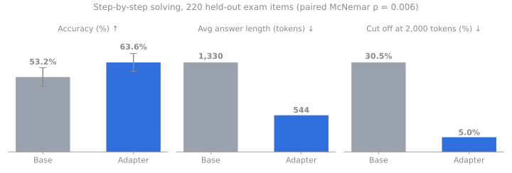
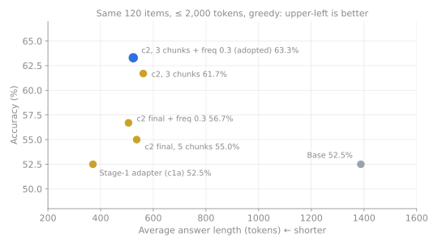
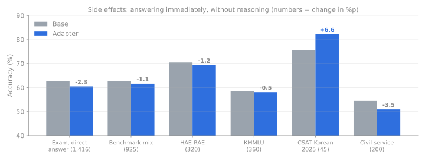

# I fine-tuned a 35B model on an 8 GB GPU

**English** | [한국어](README.ko.md)

> A personal research log: adding a LoRA to Qwen3.6-35B-A3B (MoE) so it solves Korean exam questions step by step, better and shorter.

## How it started

My PC is ordinary: RTX 3070 8 GB, 16 GB RAM, Ryzen 5 5600X. Plenty of people *run* 35B models on hardware like this. I wanted to know the next thing: **can this PC actually train one?**

Not the usual way. Even at 3 bits the model is 12.7 GB, so it never fits on the GPU, and standard training stacks can't even load it. So I looked for a way around.

## Results first

Measured on the newest exam year, which was never used for training or retrieval. Both models answer the same items, with thinking mode off, greedy decoding, and a 2,000-token cap.

| | Base | My adapter | Change |
|---|---|---|---|
| **Step-by-step accuracy** (220 items) | 53.2% | **63.6%** | **+10.4 %p** (paired p = 0.006) |
| Average answer length | ~1,330 tokens | **~540 tokens** | **2.4× shorter** |
| Answers cut off at 2,000 tokens | 30.5% | **5.0%** | 6× fewer |
| Direct answer, no reasoning (1,416 items) | **62.8%** | 60.5% | −2.3 %p |
| Korean benchmark mix (925 items) | **62.7%** | 61.6% | −1.1 %p |
| Same top-1 next token as base on held-out Wikipedia | 100% | 92.4% | gate ≥ 92% ✔ |

In one line: **more right answers in less than half the length.** It isn't free. Direct answers got a little worse, and general knowledge dropped about 1 point. So my chat app turns the adapter on only for multiple-choice exam questions.

<b>How solid is the +10.4 %p?</b>

- **Paired test.** Both models answered the same 220 items. The adapter alone got 44 right, the base alone 21 (McNemar exact test, p = 0.006).
- **Replicated.** I chose the settings on the first 120 items (+10.8 %p, p = 0.041). Then I ran 100 fresh items with nothing changed: 54.0% → 64.0%, the same gap again.
- **Larger set.** On all 300 held-out items the adapter scores 63.7%.
- **Answer-position bias checked.** The prompt's format example ends in "③". The base model picks ③ too often (78 times; ③ is correct only 51 times). The adapter doesn't (57). Counting only items whose answer is *not* ③, the gap grows to +13.7 %p.

### Versus thinking mode

The base model has a built-in thinking mode. Turning it on uses far more tokens and did not help here. This uses the first 60 items only, so treat it as a reference.

| Setup (same first 60 items) | Accuracy | Tokens per item |
|---|---|---|
| Base, thinking on (budget 3,000) | 48.3% | ~2,970 |
| Base, thinking off | 50.0% | ~1,390 (120-item average) |
| **Adapter, thinking off** | **56.7%** | **~540** |

### What made the difference (ablation, same 120 items)

| Configuration | Accuracy | Ends with a clear answer | Cut off | Avg tokens |
|---|---|---|---|---|
| Base | 52.5% | 74.2% | 32.5% | 1,388 |
| Stage-1 adapter (official solutions only) | 52.5% | 89.2% | 5.8% | 371 |
| c2, all 5 chunks | 55.0% | 92.5% | 5.8% | 537 |
| c2, all 5 chunks + freq penalty 0.3 | 56.7% | 95.8% | 3.3% | 506 |
| c2, 3 chunks | 61.7% | 94.2% | 5.8% | 562 |
| **c2, 3 chunks + freq penalty 0.3 (adopted)** | **63.3%** | **95.0%** | **4.2%** | **524** |

- Stage 1 taught only the *format*: answers got shorter and ended cleanly, but accuracy stayed the same.
- The real gain came in stage 2, which trained on step-by-step solutions.
- Training longer made it worse. The 5-chunk checkpoint scored lower *and* failed the forgetting gate.

### Side effects

| Benchmark (answer immediately) | Items | Base | Adapter |
|---|---|---|---|
| Exam, all subjects | 1,416 | **62.8%** | 60.5% |
| HAE-RAE Bench | 320 | **70.6%** | 69.4% |
| KMMLU (12 subjects) | 360 | **58.6%** | 58.1% |
| CSAT Korean 2025 | 45 | 75.6% | **82.2%** |
| Civil-service exams | 200 | **54.5%** | 51.0% |
| **All benchmarks** | **925** | **62.7%** | 61.6% |

Every benchmark dropped slightly except Korean reading, which went up. The adapter learned to *solve first, then conclude*, so when asked to answer instantly it does slightly worse.

### Cost on this PC

| Approach | What has to fit | Works on 8 GB VRAM / 16 GB RAM? |
|---|---|---|
| Standard LoRA (16-bit, PEFT) | ~70 GB of weights | ✘ can't even load |
| QLoRA (4-bit) | ~18 GB of weights (estimate) | ✘ |
| **This repo** | ~6–7 GB VRAM, ~70 GB SSD per chunk | **✔** |

| | Value |
|---|---|
| Training time | ~37 min per chunk (record 23 + train 14); the adopted checkpoint is 3 chunks, about 2 hours |
| Gated DeltaNet speedup | 3.6 h → 7 min per epoch (~40×), within 1e-6 of the reference |
| Chat speed with the adapter | ~52–55 tokens/s (VRAM ~7.7 GB, engine RAM ~8.5–9 GB) |
| Expert-cache tuning (no adapter) | 38 → 59.5 tokens/s (llama.cpp's built-in cache; I only tuned its settings) |

## How it fits in 8 GB

**1. Record the experts, don't train them.** Most of an MoE's weight sits in its routed experts. Instead of loading them onto the GPU, I let the real engine (llama.cpp) run as usual and record every expert output. A PyTorch rewrite of the rest (attention, Gated DeltaNet, norms, shared expert) plugs those outputs in as constants. The 12 GB of expert weights never touches the GPU, and the gradients are still exact.

**2. Split the work across GPU, RAM and SSD.** The recorded activations are about 125 KB per token, roughly 70 GB per 460k-token chunk. Each chunk goes to SSD, gets trained for one epoch, then gets deleted.

**3. A 40× speedup from one fix.** Computing Gated DeltaNet token by token made one epoch take 3.6 hours. A 64-token chunked form (WY/UT transform) brought it to 7 minutes, matching the reference within 1e-6.

**4. Keep it from forgetting.** A strong KL penalty (weight 12) keeps the model close to the original on ordinary text. Every checkpoint must also pass a gate: at least 92% top-1 next-token agreement with the base model on Wikipedia. The final checkpoint fell to 91.3% and was rejected. I kept the one after 3 of 5 chunks.

## The road here

Training wasn't the plan at first. It started with just getting a big model to run on this PC, then adding knowledge, then making it remember things from one mention, and finally touching the weights. I wrote it up as 8 posts (in Korean): **→ [research log](research/README.md)**

The full technical report (method, every measurement, limitations) is in **[REPORT.md](REPORT.md)**.

## What's here and what isn't

- `src/`: training and evaluation pipeline (code map in REPORT.md §7)
- `REPORT.md`: technical report
- `research/`: 8 step-by-step research posts
- **Not included:** model weights, the adapter, training data, and how the data was collected
  - Training data: about 2,900 private Korean step-by-step solutions made with several teacher LLMs, filtered by automatic answer matching and repetition-loop filtering.

## Running it yourself

- llama.cpp (Windows CUDA build) for `llama-server`, and to build `src/hm_host.cpp` against `llama.h`
- Python 3.11+, PyTorch with CUDA, then `pip install -r requirements.txt`
- Paths come from environment variables: `MODEL`, `ENGINE`, `HM_DATA`, `EXAM_DATA`, `RESULTS`, `LAB`

## Citation

See [CITATION.cff](CITATION.cff) (GitHub shows a "Cite this repository" button).

## License

CC BY-NC 4.0: non-commercial research and education only. See [LICENSE](LICENSE). The base model and llama.cpp keep their own licenses.
